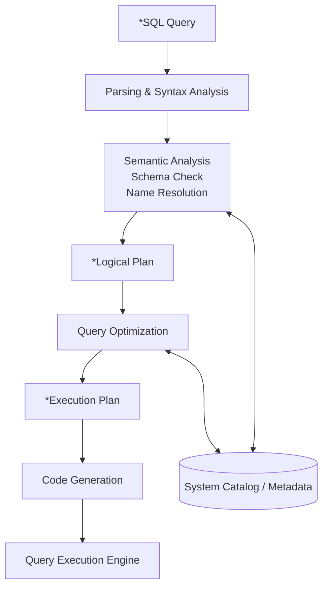

SQL (Structured Query Language) 是结构化查询 (声明式) 语言, 专用于与数据库交互和通信. 功能:

* Definition: 定义数据库对象
* Manipulation (CRUD): 查询、修改、插入、删除
* Control: 主要指访问控制模型
* Transaction: 数据库事务处理

## Fundamental Concepts 

Database (数据库)  

Table (表) is a structured listing of certain types of data 

Column (列) is a column represents a *field* within a table

Row (行) is a row represents a single *record* in a table

Schema (模式) deescribes the structural information of a database and tables 

Primary Key (主键) is a column (columns) that uniquely identifies each row, which always be defined in any table: 
* Values in a primary key column should not be upadted 
* Values in a pramary key column should not be reused 
* Primary Keys should not be based on values that may change in the future 

View (视图) is essentialy a stored query that appears as a virtual table to the user 

Index (索引) uses a B-Tree structure to reduce the time complexity of SQL queries.

CRUD: Create & Read & Update & Delete Data 

## SQL Implementation 

在底层，SQL 表按内存页存储，新插入数据会直接附加在现有内存后，可能是无序的。如 InnoDB 等引擎，会用 B-Tree 给 PRIMARY KEY 建立独立索引，但是其他辅助性索引需要用户自行创建，用内存消耗换取索引速度。

* Location Plan(Query Tree): 关注查询语义信息，进行语句的关系代数优化。
* Execution Plan(Execution Code): 关注物理执行开销。

Category | Commands | Purpose 
--------|----------|---------
Querying | `SELECT .. WHERE .. ORDER BY` | Retrieve and filter data
Joining & Aggregation | `JOIN, GROUP BY ... HAVING`, `SUM(), COUNT()` | Combine and summarize data
Window Analytics | `OVER (... PATITION BY)` `LAG(), RANK()` | Analyze relationships between rows
Data Manipulation (DML) | `INSERT, UPDATE, DELETE, MERGE` | Modify existing data
Data Definition (DDL) | `CREATE, ALTER, DROP` | Define and modify database structure
Trasaction Control (TCL) | `BEGIN, COMMIT, ROLLBACK` | Manage transactions
Access Control (DCL) | `GRANT, REVOKE` | Manage permissions

