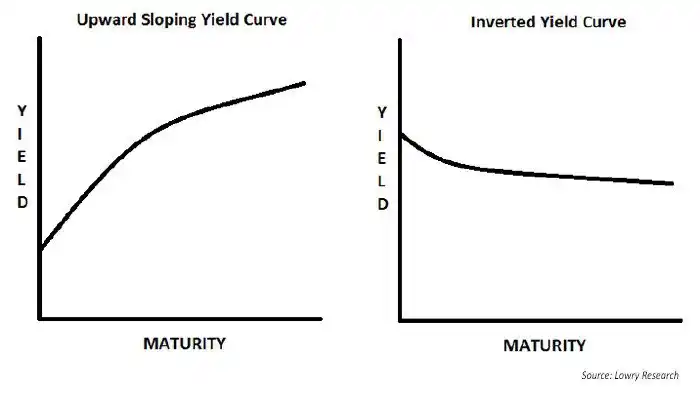

## Money Market

The money market is the term used to include all **short-term** financial instruments
which are baed on a *interest rate*.

市场参与者：

* Borrower / Lender
* Broker / Dealer

市场风险：

* Credit Risk. Borrower may fail to repay
* Liquidity Risk. Cannot sell assets into cash quickly
* Market Risk. Assets value changes due to rate monvements
* Inflation Risk.

### Day/Year Convention

Different markets use different date convention:

| Convention | Purpose | Rule |
|---|---|---|
| Following | Business-day adjustment | Move to next business day |
| Modified Following | Business-day adjustment | Move forward; if month changes, move backward |
| Preceding | Business-day adjustment | Move to previous business day |
| Modified Preceding | Business-day adjustment | Move backward; if month changes, move forward |
| End-of-Month (EOM) | Date generation | Preserve month-end status |
| Roll Date | Schedule generation | Keep dates on a fixed day, e.g. the 15th |
| IMM Date | Standardized schedule date | Usually the third Wednesday of Mar/Jun/Sep/Dec |
| Stub | Irregular accrual period | Short/long first or last period |
| Spot Lag | Settlement timing | T+0, T+1, T+2, etc. |
| Day Count | Interest calculation | ACT/360, ACT/365F[^1], 30/360[^2], ACT/ACT |

[^1]: *Actual/365 Fixed*, actual days divided by 365

[^2]: *30/360*, assume 30 days for a month, 360 days for a year

假设某个产品在 31 Jan 买入，一月后结息，使用 EOM (End-End Rule) 和 Modified Following 规则，那么，
根据 EOM 惯例，保留“月末”这个属性，那么下个月结息日会是 28 Feb；假设这天不是 Business day，
向后延期一天到 1 Mar。Modified Following 不允许跨月，会从 Following 改为 Preceding，最终计息
日期是 27 Feb。

### Yield Curve

## Money Market Instruments

Money Market 工具属于短期、低风险、高流动性货币工具，短期内借钱来服务于流动性。  
Derivatives 则主要是钱生钱工具，建立在底层工具之上。

Govern or Municipal Debt:  

* Treasury Bill (T-bill, 国库券),  政府发债。极低风险和极高流动性。

Bank Debt:

* Time Deposit (定期存款), 银行借钱，一般不可交易或无代价撤销。
* Certificat of Deposit (CD, 大额可转让存单), 银行借钱，固定利率和时间。
* Pepurchase Agreement (Repo, 回购协议), 用证券抵押 (Secured) 来借钱。主要用于调整银行流动性
* Fed Funds (Interbank, 银行间拆借)，用于管理准备金

Corporate Debt:

* Commercial Paper (CP, 商业票据), 公司借钱，风险高一些。
* ~~Corporate bonds (not included in monney market)~~

Foreign Exchange Instruments:

* FX Swaps, Exchange of currencies today with a reverse exchange at a future date.

## Money Market Derivatives

*Futures* (期货):   
a contract to but/sell an asset at a specified price on a future date.
The underlying asset is usually: govn bonds, stock index, interest rates, commodity. 

[*FRA (Forward Rate Agreement)*](./forward-rate.md):  
an OTC (场外交易) forward contract that locks in an interest rate for a future period. 

[*Options*](./options.md):   
Calls & Puts 

[*Swaps*](./swaps.md):

## RR (Risk-Free Rate)

### US SOFR (Secured Overnight Financing Rate)

* Secured: 有美国国债作抵押
* Overnight：当日隔夜利率
* Transaction-based: 基于实际市场交易

由于每日结算利率，因此每期存款利率不能提前知晓，需要累计每日隔夜利率（复利计算），到期末确定最终利息。

### CN DR007 & FR 007

境内人民币的利率基准不适用 LIBOR，不同市场有不同基准（利率基准不统一）：

* 7D Reverse Repo Rate: 央行政策利率
* DR007: 银行间市场利率。存款类机构7天质押式回购加权平均利率
* FR007: 银行间7天回购定盘利率
* LPR: 贷款市场报价利率

## Glossary

Eurocurrency: offshore US dollar 

Coupon / Yield: 

Hedging / Speculation / Arbitrage: 金融衍生物的三种目的 套期保值（对冲）/ 投机 / 套利。
投机是指预测未来价格变化 (Price Movement)，套利则是利用不同市场价格差 (Price Discrepancy). 
