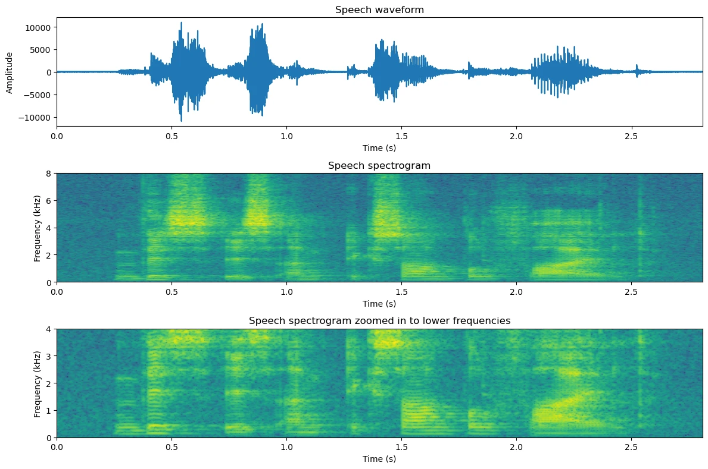
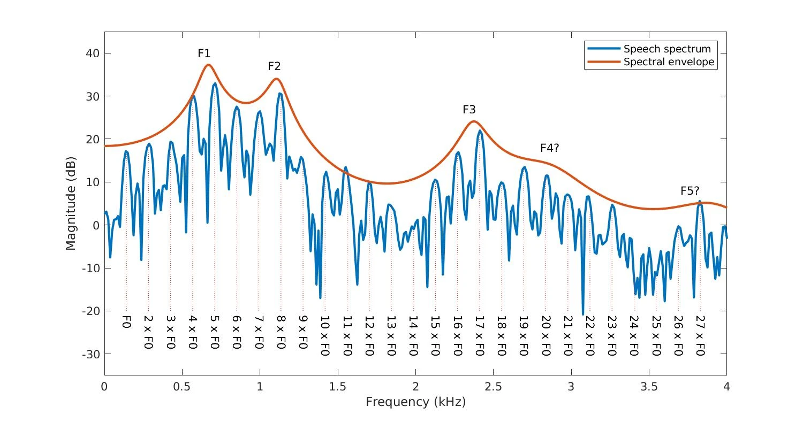

## Acoustics

Sound is a mechanical wave produced by vibrations.

*Decibels (dB)* is a log unit expressing the ratio between two quantities, rather than an absolute 
value. Sound Pressure Level (SPL, 声压级别):

$$
L_p = 20 \log_{10}(\frac{P_1}{P_0})
$$

* $P_1$ root-mean-square sound pressure, in `Pa`
* $P_0 = 20 \mu Pa$ standard reference pressure in air 

So, +3dB will twice the sound intensity, +6dB will twice the sound pressure amplitude.

## Speech Production

<figure>
  
  <figcaption>Source: <a href="https://speechprocessingbook.aalto.fi/introduction/speech-production-and-acoustic-properties/">@tom2022</a></figcaption>
</figure>

人体说话时，肺部发出气流，带动*声带 (vocal folds)* 震动，产生基础音高语调。
接着，气流经过声道（咽腔 pharynx, 口腔 oral cavity, 鼻腔 nasal cavity) 产生一些频谱改变和偏移，最终发出声音。

* 声带震动 (oscillation) 产生基频 (F0, Fundamental Frequency)，也叫浊音 (Voiced Speech) 
* 声道（口腔、咽腔）共振 (resonance) 产生共振峰 (F1 / F2, Formants)，产生清音 (unvoiced)

F0 越高，声音*音高 (pitch)* 越高。以吉他拨弦为例，拨弦更用力，只影响声音的响度；只有弦本身更紧，
才能产生更高的频率，音高升高。

## SPeech Processing 

<figure>
  
  <figcaption>Source: <a href="https://speechprocessingbook.aalto.fi/representations/spectrogram-and-the-stft/">Tom Bäckström</a>, Waveform & Spectrogram</figcaption>
</figure>

声谱图的绘制需要借助 STFT (Short-Time Fourirer Transform) 技术，核心步骤为：

* Framing, 将时间拆分为滑动帧，逐个帧计算 FFT，帧是滑动的（有重叠）
* Windowing, 由于录制的声音信号可能不是完整（自然衔接）的周期信号，需要乘上一个*窗函数*，让边界处衰减到零，来避免 FFT 频谱泄露。
* FFT (DFT) ，得到每个时间窗口的所有频率分解
* 对应得到幅度值 $S[m,k]=| \text{STFT}(x)[m,k]|$ ，其中 $m$ 是时间帧、$k$ 是频率格点 

为了强化声音的强弱差异，通常将幅度转化为分贝，然后映射为最终声谱图的颜色：

$$
D[m,k]= 20\log_{10}(\frac{S[m,k]}{S_\text{ref}})
$$

常见的情形：
* 水平亮线：一个稳定的纯音，真实乐器通常还有 880Hz, 1320Hz 等谐波形成的多条水平线
* 竖线：短暂的宽频瞬态，比如突然的敲击
* 人声见下图。蓝色曲线的小尖峰就是谐波，橙色曲线的大峰是共振峰 (Formants) 。基频 $F_0$ 则决定了整体的音高。

<figure>
  
  <figcaption>Source: <a href="https://speechprocessingbook.aalto.fi/introduction/speech-production-and-acoustic-properties/">Tom Bäckström</a></figcaption>
</figure>

